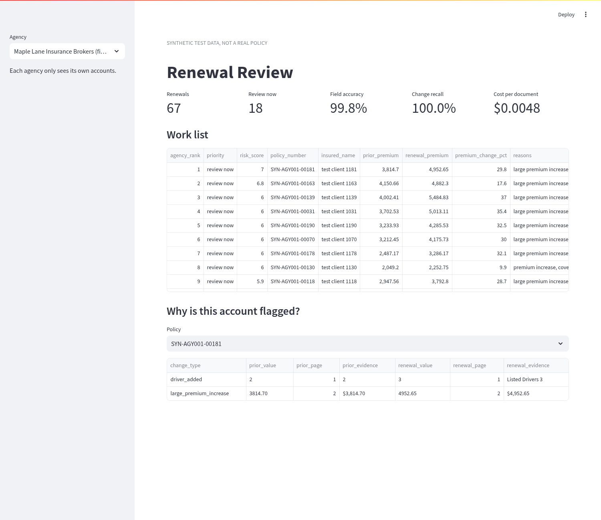
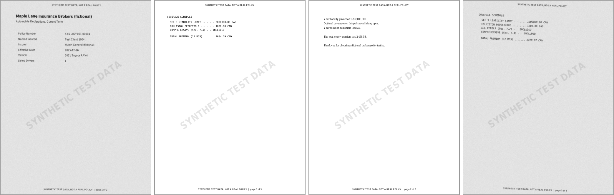
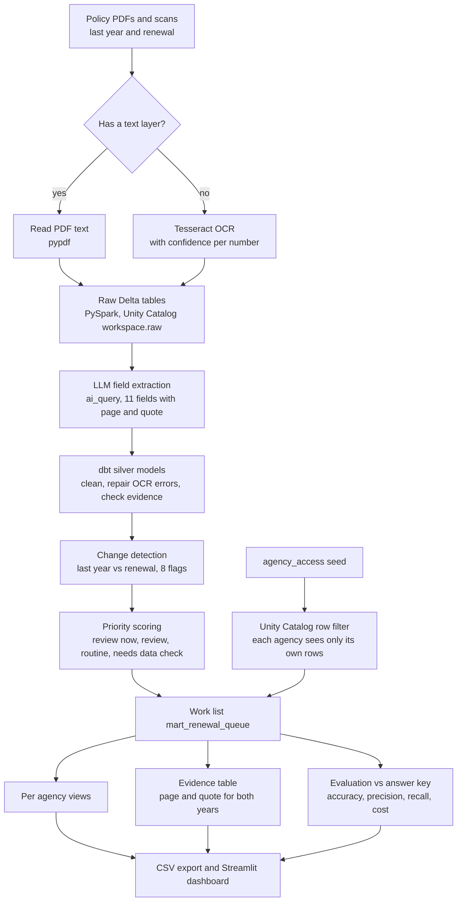
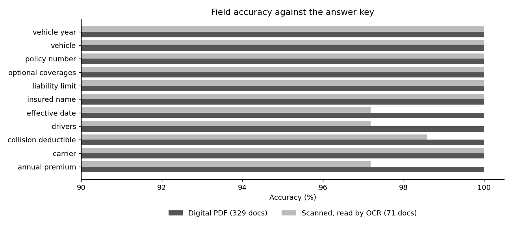

# Renewal Review Pipeline

**Reads last year's auto policy and the renewal, finds the risky changes, and gives each insurance agency a ranked work list with proof.**

Every year a broker gets a renewal offer for each client: a new premium, maybe a higher
deductible, maybe a coverage that quietly disappeared. Nobody has time to read every renewal
next to last year's policy, so the risky ones slip through.

This project reads last year's policy and the renewal for the same client, pulls out the key
fields, compares them, and gives each agency a ranked work list of the accounts a person should
look at first. Every number points back to the page it came from, and each agency only sees
its own clients. It runs on Databricks with Delta tables, Unity Catalog and dbt.

> All policies in this repo are made up. Every page is stamped
> "SYNTHETIC TEST DATA, NOT A REAL POLICY".



## The problem we are trying to solve

When a client's auto policy comes up for renewal, the carrier (the insurance company) sends a
renewal offer. The broker, the person who looks after the client, should compare it with last
year's policy before the client accepts. In practice a busy agency renews hundreds of policies a
month and cannot read them all side by side.

What slips through:

- **Premium increase:** the yearly price goes up 20 or 30 percent and nobody shops it around.
- **Coverage dropped:** an optional coverage, such as collision, quietly disappears. The client
  finds out only after an accident.
- **Higher deductible:** the amount the client pays first on a claim goes from $500 to $1,000.
- **Lower liability limit:** the most the policy pays if the client injures someone drops from
  $2M to $1M.

Each one costs the client money or protection, and costs the agency trust.

Companies like Quandri solve this with software that reads every renewal. For the data behind it
to be trusted, three things matter:

- **Per agency isolation (multi tenancy):** many agencies share one platform, and the data holds
  client details (PII, personally identifiable information). One agency must never see another
  agency's clients.
- **Traceability (provenance):** every number shown to a broker must point back to the document
  and page it came from, so it can be checked.
- **No double counting (idempotency and dedup):** rerunning the pipeline or reloading a file must
  not create duplicate policies or count a change twice.

## What we found using the public data

**Base wording.** We used the public FSRA Ontario Automobile Policy, OAP 1 (the standard owner's
policy every Ontario insurer must use, July 2026 version, 68 pages) for real coverage names and
section numbers. The PDF is downloaded from FSRA and checked by checksum, not stored here.

**Test data.** Real policies are private, so we made 200 synthetic clients across 3 fictional
agencies, each with last year's policy and a renewal (400 documents). We planted the changes
ourselves, so the right answer is known (an answer key, or ground truth). The agencies use
different layouts, and 71 documents are scanned looking images that need OCR (optical character
recognition, turning a picture of text into text).

**Measured results** on Databricks, all 400 documents:

- **Field accuracy:** 99.84% of 4,400 fields right. 100% on digital PDFs, 99.1% on scans.
- **Change detection:** 193 real changes, 100% precision (no false alarms) and 100% recall
  (none missed).
- **Work list:** the priority matches the answer key for 200 of 200 accounts.
- **Traceability:** 100% of values cite a page that exists and quote text found on that page.
- **Isolation:** 0 cross agency leaks across every broker and agency pair tested.
- **No double counting:** every pair has exactly one last year and one renewal row (dbt test),
  loads replace tables instead of appending, and extraction is incremental, keyed on the
  document, a hash of its text and the prompt version, so a rerun never adds a second copy.
- **Cost and speed:** $0.0048 per document at list price, about 0.43 seconds each in a batch.

**Weak spots found and fixed:**

- A "COLLISION DEDUCTIBLE" line was read as collision coverage. Dropped coverage precision went
  from 65% to 100% after clearer rules and a text check.
- OCR garbled policy numbers (`SYN-AGY@@2`). Matching to the agency's own policy list took them
  from 73% to 100% on scans.
- OCR garbled names (`huron genera!`). Matching to known carriers and vehicles fixed them.
- OCR read years as 2625. Years after 2030 are corrected.
- A few scanned numbers cannot be fixed from the page. Those accounts are now marked "needs data
  check", and all 7 of them are caught.

## Final verdict

**Does the approach work?** Yes, on this test set. Reading renewals with a model inside
Databricks, cleaning the values in dbt, and comparing the two years finds every planted change
with no false alarms, at about half a cent per document.

**What it proves:**

- Field extraction can run as an ordinary, incremental dbt model on Databricks (`ai_query`),
  next to the data, with no separate service.
- Every value can carry its page and quote, and a test can enforce that.
- Agency isolation can be enforced in Unity Catalog (Databricks' permission layer) with a row
  filter, and tested.
- The pipeline knows when it might be wrong and sends those accounts to a person instead of
  guessing.

**Honest limits:**

- The documents are synthetic. Real carrier PDFs are longer, messier and vary more.
- 7 numbers on scanned pages are still wrong; they are flagged, not fixed.
- The risk weights are a sensible start, not tuned with real broker decisions.
- Row filter tests check the access rule; a live login as a broker is still a manual check.
- Cost is an estimate at list price; Free Edition cost nothing.

## The problem in more detail

- A mid size agency renews hundreds of auto policies a month, and each renewal comes as a PDF
  from a different carrier with a different layout. Some are scans.
- The things that matter are small: a 25 percent price jump, a deductible going from $500 to
  $1,000, collision coverage gone, liability cut from $2M to $1M.
- A broker needs to know which accounts to call this week, and why, with proof.
- The data has client details in it, so one agency must never see another agency's accounts.

## The data

| Source | What it is | Rows |
| --- | --- | --- |
| FSRA Ontario OAP 1 | The standard Ontario owner's auto policy (July 2026 version), used for real coverage names and section numbers | 68 pages |
| Synthetic policies | 200 clients across 3 fictional agencies, each with last year's policy and a renewal. Changes are planted so the right answer is known | 400 documents, 934 pages |
| Agency policy list | Policy number and client name per agency, like an export from an agency management system | 200 policies |

The three agencies use different layouts on purpose: a clean table, an all caps carrier form
over three pages, and a friendly letter where the facts sit inside sentences. 71 of the 400
documents (18 percent) are turned into scanned looking images with rotation, grey noise and
blur, so they have to go through OCR. See [docs/sources.md](docs/sources.md) and
[docs/synthetic-data-plan.md](docs/synthetic-data-plan.md).



## How it works



1. **Render and read.** `render.py` builds the PDFs. `pages.py` reads the text layer, or runs
   Tesseract OCR on scanned pages and keeps the confidence of every number it reads.
2. **Load.** `load_raw.py` writes the raw tables to `workspace.raw` on Databricks (or to local
   Delta tables for offline work).
3. **Extract** (`int_extraction_raw`). One `ai_query` call per document on the
   `databricks-gemini-3-5-flash` endpoint. The model returns 11 fields as JSON, and for each one
   the page number and the exact text it used. The model is told which page is which.
   The model is called incrementally, so a document is only sent again when its text or the
   prompt changes.
4. **Clean and repair** (`int_extracted_fields`).
   - Money, dates and coverage names are put in one format.
   - OCR mistakes are repaired against things the agency already knows: its own policy numbers,
     client names, carriers and vehicle models. A fix is only accepted within 3 edits.
   - A year like 2625 (OCR read the 0 as a 6) is put back to 2025.
   - On digital documents, a coverage is dropped if its name does not appear in the text.
   - Every value is checked: does the quoted evidence really appear on the cited page?
5. **Compare** (`fct_renewal_changes`). Eight change flags: large premium increase (over 15
   percent), premium increase (5 to 15 percent), deductible raised, liability lowered, coverage
   dropped, driver added, vehicle changed, carrier changed.
6. **Rank** (`mart_renewal_queue`). A weighted score puts each account in "review now",
   "review" or "routine". Losing coverage or liability weighs most. Accounts where a number
   might be misread are marked `needs_data_check`: renewal date not one year after last year's,
   policy numbers that do not match, a key field missing, or an OCR number read with low
   confidence.
7. **Evidence** (`fct_change_evidence`). Each flagged change with the page and quoted text for
   both years, so a broker can check it in seconds.
8. **Isolation.** The work list has a Unity Catalog row filter. A user sees an agency's rows only
   if `agency_access` grants it. There is also one view per agency.
9. **Evaluation** (`models/eval`). Field accuracy, change detection precision and recall, work
   list agreement, data check catch rate, and cost.

dbt runs 60 models, seeds and tests on Databricks, all passing.

## Stack

| Layer | Tools |
| --- | --- |
| Platform | Databricks (GCP workspace), Unity Catalog |
| Storage | Delta Lake (delta-spark 3.2.1) |
| Processing | PySpark 3.5.3, Databricks SQL connector |
| Document reading | pypdf, pdf2image with poppler, Tesseract OCR (pytesseract) |
| Field extraction | Databricks `ai_query` on the `databricks-gemini-3-5-flash` endpoint |
| Transformations and tests | dbt-core 1.9.4, dbt-databricks 1.9.7, dbt-spark 1.9.2 for local runs |
| Synthetic documents | Python, reportlab, Pillow |
| Dashboard | Streamlit, pandas |
| Packaging and tests | Docker, Docker Compose, Make, pytest |

## Results

Measured on Databricks on Oct 16, 2026, on all 400 documents.

| Measure | Result |
| --- | --- |
| Field accuracy, all 4,400 fields | **99.84%** (4,393 correct) |
| Field accuracy, digital PDFs (329 docs) | **100%** |
| Field accuracy, scanned docs (71 docs) | **99.1%** (7 misread numbers) |
| Change detection, 193 real changes | **100% precision, 100% recall** |
| Work list priority matches the answer key | **200 of 200 accounts** |
| "Review now" accounts found | **71 of 71**, no extras |
| Misread accounts marked "needs data check" | **7 of 7** (18 more were marked but fine) |
| Evidence quote found on the cited page | **100%** of values, every cited page exists |
| Model cost | **$0.0048 per document**, $1.92 for all 400 (list price, about 693 input and 310 output tokens each) |
| Extraction time | 171 seconds for 400 documents in one batch, about 0.43 seconds each |
| Cross agency leaks | **0** (dbt tests over every broker and agency pair) |



### What we fixed along the way

The first full run was weaker. Each problem was fixed in the pipeline, then measured again.

| Problem found | Fix | Before | After |
| --- | --- | --- | --- |
| Model listed collision as a coverage because of a "COLLISION DEDUCTIBLE" line | Clearer coverage rules in the prompt, NONE printed on empty schedules, and a text check on digital docs | coverage dropped precision 65% | 100% |
| OCR garbled policy numbers (`SYN-AGY@@2`, `AGYO92-p9059`) | Match to the agency's own policy list, fall back to the client name | 73% on scans | 100% |
| OCR garbled names (`huron genera!`, `tesia model 3`) | Match to known carriers and vehicle models | 99.0% | 100% |
| OCR read years as 2625 | Fix years after 2030 | 4 wrong dates | 2 wrong dates |
| Misread premiums could not be fixed from the page | Flag low OCR confidence, date mismatches and missing fields as "needs data check" | 4 of 8 caught | 7 of 7 caught |
| Overall change detection | All of the above | 94.2% precision | 100% |

### Honest limits

- The documents are synthetic. Real carrier PDFs are messier, longer and have more fields.
  The scanned ones here have light noise compared with a fax.
- 7 numbers on scanned pages are still misread (2 premiums, 2 dates, 2 driver counts, 1
  deductible). They cannot be fixed from the page alone, so they are flagged for a person
  instead. In this run none of them changed a flag or a priority, but that was partly luck.
- The cost is at Databricks list price for this endpoint. On Free Edition it cost nothing.
- Row filter tests check the rule for every broker and agency. A test cannot log in as another
  user, so the live check for a real broker account still has to be done by hand.
- The weights in the risk score are a sensible starting point, not tuned on real broker
  decisions.

## Run it on a Mac

You need Docker Desktop. Everything runs in Docker.

```
git clone <this repo>
cd renewal-review-pipeline
cp .env.example .env        # fill in DATABRICKS_HOST, DATABRICKS_HTTP_PATH, DATABRICKS_TOKEN
docker compose build
```

Offline check, no Databricks needed (tests, FSRA download, PDFs, OCR, local Delta tables, dbt staging):

```
docker compose run --rm app make smoke
```

Full pipeline on Databricks, then the dashboard:

```
docker compose run --rm app make databricks
docker compose up dashboard
```

Open http://localhost:8501. The dashboard reads the CSV files in `results/`, so it also works
straight away with the results already in the repo.

Useful pieces on their own:

```
docker compose run --rm app make load-databricks     # reload raw tables
docker compose run --rm app make dbt-databricks      # dbt build on Databricks
docker compose run --rm app make export              # refresh results/*.csv
```

## Repo layout

```
src/renewal_review/   data generation, PDF rendering, OCR, loaders, export
dbt/models/staging    raw tables as views
dbt/models/silver     extraction, cleaning, repair, typed policies
dbt/models/gold       comparison, work list, evidence, agency views
dbt/models/eval       accuracy, change detection, data checks, cost
dbt/tests             leak tests, traceability, row filter checks
dashboard/            Streamlit work list
results/              exported results and summary
```
